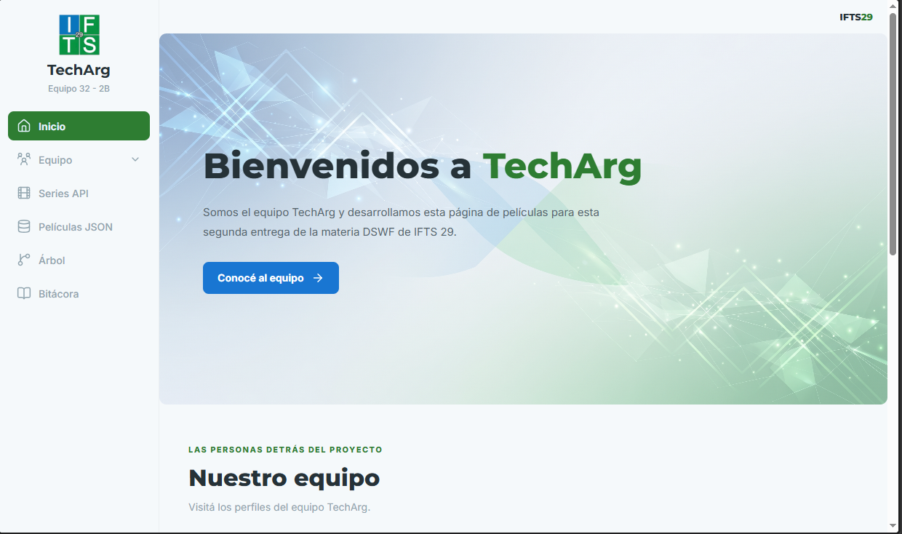
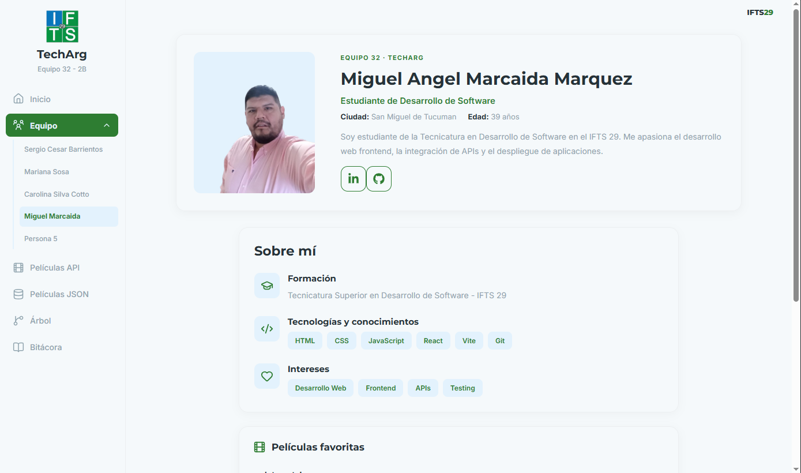
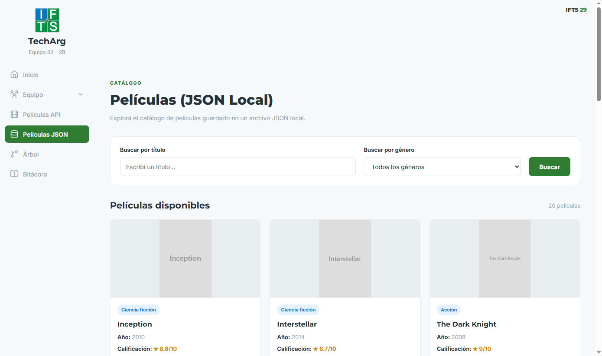
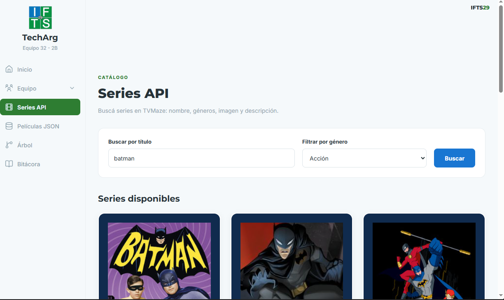
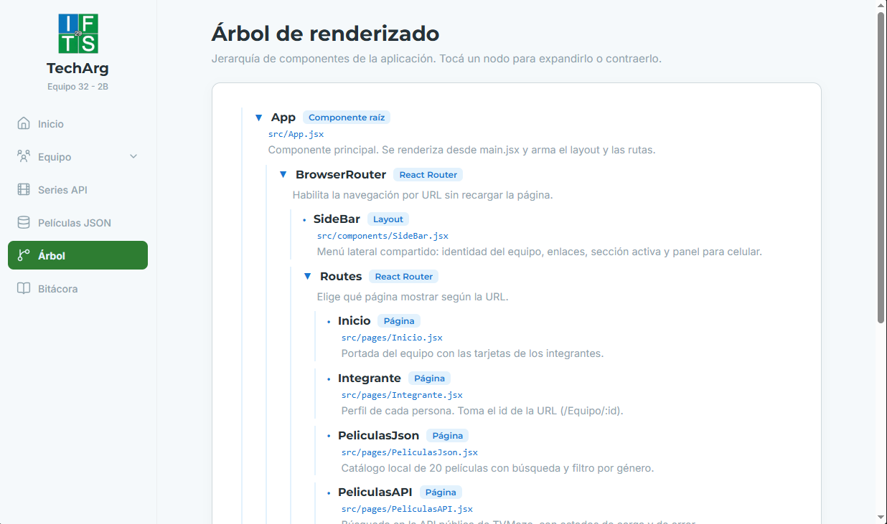
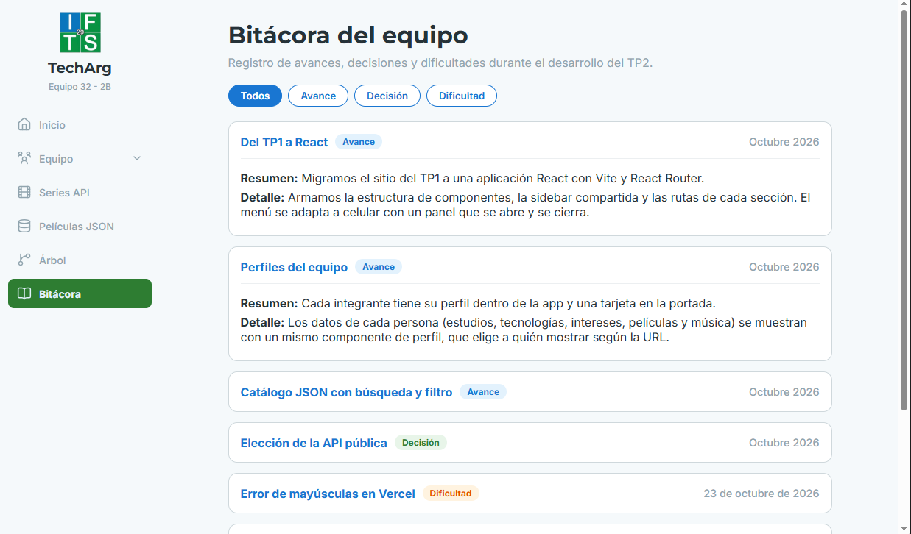

🇦🇷 TechArg — TP2 | Proyecto React en equipo

<p align="center">


</p>

<p align="center">
<strong>Trabajo Práctico Grupal 2 · Desarrollo de Sistemas Web (Front End)</strong>
<br />
Tecnicatura Superior en Desarrollo de Software a Distancia
<br />
🏫 IFTS 29 · 👥 Equipo 32 — 2.º B
<br />
📅 2.º cuatrimestre de 2026
</p>


## Índice

- [Descripción del proyecto](#descripción-del-proyecto)
- [Sitio publicado](#sitio-publicado)
- [Integrantes](#integrantes)
- [Uso de IA](#uso-de-ia)
- [Tecnologías, herramientas y librerías](#tecnologias)
- [Cómo correr el proyecto](#-cómo-correr-el-proyecto)
- [Capturas](#capturas)

## Descripción del proyecto

**TechArg** es una aplicación web hecha con React que presenta a nuestro equipo y organiza sus contenidos. Continúa el proyecto del TP1 y lo lleva a React, con una sidebar compartida que permanece visible mientras cambia el contenido de cada sección.

Para esta segunda entrega, elegimos un diseño minimalista, limpio y ordenado, inspirado en una red social de perfiles. Buscamos una interfaz clara e intuitiva, con una paleta de colores suaves y equilibrados que aporte una apariencia más moderna y visualmente ligera en comparación con la versión del TP1.

## ✨ Funcionalidades principales

- **Portada:** presentación del equipo y acceso a los perfiles individuales mediante tarjetas interactivas.
- **Perfiles:** una página por integrante con información personal, formación, tecnologías, intereses, películas y música favoritas.
- **Menú hamburguesa:** navegación lateral adaptable a dispositivos móviles, con apertura y cierre del menú, fondo superpuesto y cierre automático al seleccionar una sección.
- **Diseño responsive:** adaptación de la interfaz a diferentes resoluciones y dispositivos, incluyendo escritorio, tablets y celulares.
- **Películas (JSON local):** catálogo de 20 películas con búsqueda por título, filtro por género y tarjetas expandibles que muestran información adicional.
- **Series API (TVMaze):** consulta de series mediante una API pública, con búsqueda por título, filtro por género, estados de carga, manejo de errores y posibilidad de reintentar la consulta.
- **Árbol de renderizado:** representación de la jerarquía de componentes de la aplicación.
- **Bitácora:** registro de avances, decisiones y dificultades durante el desarrollo del proyecto, con filtros por categoría.

## ⚛️ Hooks de React y manejo de estados

Durante el desarrollo utilizamos diferentes hooks de React y herramientas de React Router para gestionar estados, controlar efectos secundarios y administrar la navegación de la aplicación.

### ⚛️ Hooks de React

- **`useState`:** utilizado para administrar los estados de los componentes y controlar las interacciones del usuario, como la apertura del menú hamburguesa, la selección de tarjetas, los filtros de búsqueda, las tarjetas expandibles y los resultados de la API.
- **`useEffect`:** utilizado en la sección Series API para ejecutar consultas a TVMaze cuando cambia el término de búsqueda, actualizando los resultados y controlando los estados de carga y error.

### 🧭 Hooks y herramientas de React Router

- **`useNavigate`:** permite realizar navegaciones programáticas entre las distintas secciones y los perfiles de los integrantes.
- **`useLocation`:** permite conocer la ruta actual para identificar la sección seleccionada en la barra lateral.
- **`useParams`:** permite obtener el identificador del integrante desde la URL y mostrar su perfil correspondiente.
- **`Navigate`:** permite redirigir al inicio cuando se intenta acceder a un perfil inexistente.

### 🛠️ Otros recursos de React

- **Renderizado condicional:** utilizado para mostrar u ocultar elementos según los estados y los datos disponibles.
- **Método `map()`:** utilizado para generar dinámicamente listas de integrantes, películas, canciones y registros de la bitácora.

## Sitio publicado

- Vercel: https://tp-2-front-end-khaki.vercel.app/

## Integrantes

| Integrante | GitHub | Responsabilidad |
| :--- | :--- | :--- |
| Sergio Cesar Barrientos | [@SergioCesarBarrientos](https://github.com/SergioCesarBarrientos) | Esqueleto del proyecto, implementación de estructura, paleta de colores & fuentes, perfil propio (datos, foto, tarjeta de portada), diseño responsive, implementación de archivos JSON. |
| Mariana Sosa | [@MaruSosa](https://github.com/MaruSosa) | Perfil propio (datos, foto y tarjeta de portada), Árbol de renderizado y Bitácora. |
| Carolina Silva Cotto | [@csilvacotto-2202](https://github.com/csilvacotto-2202) | Perfil propio (datos, foto, tarjeta de portada y entrada en la sidebar), configuración de `vercel.json` para el deploy, y redacción del README. |
| Karina Sánchez | [@karinaluciasanz](https://github.com/karinaluciasanz) | Perfil propio (datos, foto, tarjeta de presentación, integración en la página principal y ruta en Integrante.jsx) y maquetación de componentes del equipo.|
| Miguel Marcaida | [@Miguel-Marcaida](https://github.com/Miguel-Marcaida) | Perfil propio (tarjeta, ruta dinámica y datos), implementación de la API de Películas (`fetch`, `useEffect`, estados de carga y error, búsqueda por texto), conexión de rutas y ajustes de estilos. |

## Uso de IA

Declaramos las aplicaciones y los modelos de IA que usamos. Distinguimos la **aplicación** desde la que trabajamos del **modelo** que respondió.

| Integrante | Aplicación | Modelo | En qué contenido o tarea |
| :--- | :--- | :--- | :--- |
| Carolina Silva Cotto | Claude (claude.ai) | Sonnet 5.5 | Se utilizó Claude como herramienta de asistencia durante el desarrollo del proyecto, para resolver dudas técnicas y colaborar en la documentación del proyecto. |
| Sergio Cesar Barrientos | ChatGPT | Version GPT-6 | Asistencia en la integración de componentes y recomendaciones de diseño y paletas |
| Mariana Sosa | ChatGPT | Version GPT-6 | Asistencia en el desarrollo del Árbol de renderizado y la Bitácora. |
| Karina Sánchez |  Google Gemini (gemini.google.com) | Gemini 3 | Asistencia en la integración de componentes de React |
| Miguel Marcaida | DeepSeek (chat.deepseek.com) | DeepSeek-V3 | Asistencia en la resolución de conflictos de Git, creación y diseño de la tarjeta de perfil, conexión de rutas y ajustes de CSS responsivo.|

Todo lo generado con IA fue revisado, adaptado y probado por el equipo.

<a id="tecnologias"></a>
## 🛠️ Tecnologías, Herramientas y librerías

<p>


</p>

⚛️ React 19: construcción de la interfaz mediante componentes.

⚡ Vite: entorno de desarrollo y herramientas de compilación.

🧭 React Router: navegación entre las distintas secciones.

🎨 Lucide React y React Icons: iconografía de la aplicación.

☁️ Vercel: publicación del sitio web.

## 🔤 Tipografías

Montserrat: utilizada para títulos y textos destacados.

Inter: utilizada para el cuerpo de los textos, priorizando la legibilidad.

## 🎨 Paleta de colores

| Variable CSS | Color | Código |
|---|---|---|
| Color primario | Azul | `#1976D2` |
| Color secundario | Verde | `#2E7D32` |
| Color primario suave | Azul claro | `#E3F2FD` |
| Color secundario suave | Verde claro | `#A5D6A7` |
| Texto principal | Gris oscuro | `#263238` |
| Texto secundario | Gris azulado | `#90A4AE` |

## 🚀 Cómo correr el proyecto
📋 Requisitos previos

Node.js instalado.

npm instalado.

## ⚙️ Instalación y ejecución

Clonar el repositorio:

```bash
git clone URL_DEL_REPOSITORIO
```

Entrar en la carpeta del proyecto:

```bash
cd NOMBRE_DE_LA_CARPETA
```

Instalar las dependencias:

```bash
npm install
```

Iniciar el servidor de desarrollo:

```bash
npm run dev
```

Abrir en el navegador la dirección que aparece en la terminal, normalmente:

```bash
http://localhost:5173
```

📌 Reemplazá URL_DEL_REPOSITORIO y NOMBRE_DE_LA_CARPETA por los datos reales del repositorio.

## Capturas

**Portada del equipo**



**Perfil de un integrante**



**Catálogo JSON con búsqueda y filtro**



**Sección de series (API de TVMaze)**



**Árbol de renderizado**



**Bitácora**


